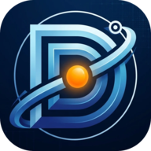

<div align="center">



# Delega Labs

**Automatización con WhatsApp para pymes de San Cristóbal y Cúcuta.**
Tu negocio atiende, cobra y cuadra solo.

[](https://delegalabs.ing-josearaqueg.workers.dev)


</div>

---

## Qué es

Sitio web de **Delega Labs**, agencia que conecta el WhatsApp de un negocio con su catálogo, sus pagos y su caja. Está pensado para equipos de 3 a 20 personas que venden en bolívares, dólares y pesos.

El objetivo de la página es uno solo: que el dueño entienda en segundos qué se automatiza y pida su diagnóstico gratis por WhatsApp.

## Secciones

| Sección | Qué muestra |
|---|---|
| **Hero** | Chat animado de una ferretería tomando un pedido con precio en Bs y USD |
| **Métricas** | Cifras de ejemplo del tipo de resultado que se busca |
| **Problema** | Los tres dolores más comunes: pedidos perdidos, cuadre multimoneda, cobranza manual |
| **Servicios** | Cuatro soluciones con precio de implementación y mensualidad |
| **Proceso** | Cómo se trabaja, paso a paso |
| **Resultados y Nosotros** | Casos de uso y quién está detrás |
| **Preguntas frecuentes** | Dudas de precio, tiempos y soporte |
| **Contacto** | Botón directo a WhatsApp con mensaje prellenado |

## Características

- Chat de demostración animado, visible desde la primera pantalla en móvil.
- Tema claro y oscuro automático (`light-dark()`).
- Respeta `prefers-reduced-motion`.
- Sin dependencias de UI: CSS propio, SVG propios, fuente Inter local.
- SEO listo: metadatos Open Graph, `sitemap.xml`, `robots.txt`, `llms.txt` y manifest PWA.
- Se sirve como assets estáticos en Cloudflare Workers.

## Stack

- [React 19](https://react.dev) + [Vite 8](https://vite.dev)
- [Cloudflare Workers](https://workers.cloudflare.com) con `@cloudflare/vite-plugin` y `wrangler`
- [Oxlint](https://oxc.rs) para lint

## Empezar

Requisitos: Node.js 20 o superior.

```bash
git clone https://github.com/JoseAGalviz/DelegaLabs.git
cd DelegaLabs
npm install
npm run dev
```

## Scripts

| Comando | Acción |
|---|---|
| `npm run dev` | Servidor de desarrollo con HMR |
| `npm run build` | Compila a `dist/` |
| `npm run lint` | Revisa el código con Oxlint |
| `npm run preview` | Compila y lo corre en local con `wrangler dev` |
| `npm run deploy` | Compila y publica en Cloudflare Workers |

## Estructura

```
.
├── public/             Favicon, iconos, og-image, manifest, robots, sitemap, llms.txt
├── propuestas-logo/    Borradores de logo
├── src/
│   ├── components/     Header, Hero, Sections, Weave, Contact, Footer…
│   ├── data.js         Textos: métricas, servicios, pasos, FAQ
│   ├── config.js       Número de WhatsApp y mensaje de saludo
│   ├── styles.css      Estilos de todo el sitio
│   └── main.jsx
├── index.html
├── vite.config.js
└── wrangler.jsonc      Configuración de Cloudflare Workers
```

## Personalizar

- **Textos, precios y preguntas:** `src/data.js`.
- **Número de WhatsApp y saludo:** `src/config.js`.
- **Colores y tipografía:** variables CSS al inicio de `src/styles.css`.

## Despliegue

```bash
npx wrangler login   # una sola vez
npm run deploy
```

El nombre del Worker está en `wrangler.jsonc`.

## Contacto

**Delega Labs** · San Cristóbal, Táchira · Cúcuta, Norte de Santander
Pide tu diagnóstico gratis de 20 minutos por [WhatsApp](https://wa.me/584127331521?text=Hola%20Delega%20Labs%2C%20quiero%20mi%20diagn%C3%B3stico%20de%2020%20minutos.).

---

<div align="center">
<sub>© Delega Labs. Todos los derechos reservados.</sub>
</div>
